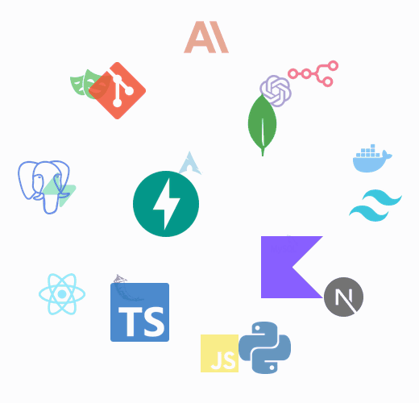

<!-- Header Banner part -->

<!-- Animated Typing Effect -->

 

<!--Night Owl image-->

  

<!--Header Name-->
#  ɪ'ᴍ ᴛᴀʏʏᴀʙ ʜᴜssᴀɪɴ!
*AI & Automation Developer · Full-Stack*
 

<!--Start Intro-->

I build AI agents that do real business work: a WhatsApp bot that takes restaurant orders, a LinkedIn agent that writes and publishes posts, and a Google Maps lead finder with WhatsApp outreach. I work across the stack and use AI coding agents to ship fast.

-  BSCS student at Superior University, based in Lahore, Pakistan.
-  Full Stack Developer at Gobind Trades Ltd since May 2026, working on their construction management software (employee app and admin dashboard).
-  I work with Python, TypeScript, React, Next.js, FastAPI, the Claude and OpenAI APIs, n8n and Playwright.
-  Past work includes the Alvis agency site, MyHomeDoc and Techspirex (WordPress).
-  Visit my [Portfolio](https://tayyabhussayn.vercel.app) for more details about me.
<!--End Intro-->

<!--Profile Count Badge-->

  

---

<!--Languages and Tools Section-->       
<h2 align="center">Tᴇᴄʜ sᴛᴀᴄᴋ & Rᴇᴄᴇɴᴛ ʙᴜɪʟᴅs</h2> 
<picture>
  <source media="(prefers-color-scheme: dark)" srcset="./Skills_Animation_Dark.gif">
  <source media="(prefers-color-scheme: light)" srcset="./Skills_Animation_White.gif">
  
</picture>
 

<h3 align="left">Current Learning</h3>
<ul align="left">
  <li>Running several AI coding agents in parallel on one codebase, each owning a module (how Smart Sticky Notes is built).</li>
  <li>Kotlin Multiplatform and Compose Multiplatform, through Smart Sticky Notes.</li>
  <li>AI voice assistants, after building a voice calling assistant for the Alvis agency.</li>
</ul>

<h3 align="left">Recent Builds</h3>
<ul align="left">
  <li><a href="https://github.com/Tayyab-Hussayn/querylens">🔥QueryLens: visual database manager for PostgreSQL, MySQL, MongoDB and SQLite 🗄️</a></li>
  <li><a href="https://github.com/Tayyab-Hussayn/leadsGen">🔥LeadsGen: finds businesses without a website on Google Maps and sends WhatsApp outreach 🤖</a></li>
  <li><a href="https://github.com/Tayyab-Hussayn/orderOnline">Order Online: restaurant site with cart, ordering, reservations &amp; admin panel 🍽️</a></li>
  <li><a href="https://www.byqalam.com/">byQalam: LinkedIn AI content agent ✍️</a></li>
  <li><a href="https://github.com/Tayyab-Hussayn/vocalize-ai">Vocalize AI: free open-source text-to-speech 🔊</a></li>
  <li>Restaurant WhatsApp Agent: takes orders in Roman Urdu and sends them to the owner 💬</li>
  <li>Smart Sticky Notes: Kotlin app showing notes and reminders on the home screen (in development) 📝</li>
</ul>
 
 
 
 

<!--Trophies Section-->
<h2 align="center">🏆 Gɪᴛʜᴜʙ Tʀᴏᴘʜɪᴇs 🏆</h2>

  <a href="https://github.com/Tayyab-Hussayn">
    <picture>
      <source media="(prefers-color-scheme: dark)" srcset="https://github-profile-trophy-ruddy.vercel.app/?username=Tayyab-Hussayn&no-bg=true&row=2&column=6&margin-w=20&margin-h=20&theme=dracula">
      <source media="(prefers-color-scheme: light)" srcset="https://github-profile-trophy-ruddy.vercel.app/?username=Tayyab-Hussayn&no-bg=true&row=2&column=6&margin-w=20&margin-h=20">
      
    </picture>
  </a>

  

 

<!--Github stats Table-->
<h2 align="center">📊 Gɪᴛʜᴜʙ Sᴛᴀᴛs 📊</h2>

<table width="100%">
  <tr>
    <td width="50%">
      <h3 align="center"><strong>Gɪᴛʜᴜʙ Sᴛᴀᴛs</strong></h3>
      

        
      

    </td>
    <td width="50%">
      <h3 align="center"><strong>Sᴛʀᴇᴀᴋ Sᴛᴀᴛs</strong></h3>
      

        
      

    </td>
  </tr>
  <tr>
    <td width="50%">
      <h3 align="center"><strong>Lᴀᴛᴇsᴛ Pʀᴏᴊᴇᴄᴛ</strong></h3>
      

        
      

    </td>
    <td width="50%">
      <h3 align="center"><strong>Tᴏᴘ Cᴏɴᴛʀɪʙᴜᴛɪᴏɴs</strong></h3>
      

        
      

    </td>
  </tr>
</table>
 

<!--Contribution Graph-->
<h2 align="center">📈 Cᴏɴᴛʀɪʙᴜᴛɪᴏɴ Gʀᴀᴘʜ 📈</h2>

    

---

<!--Dynamic Quote card updates everyday at 12 AM-->
<h2 align="center">🌟 Tʜᴏᴜɢʜᴛ ᴏғ ᴛʜᴇ Dᴀʏ 🌟</h2>

<!--STARTS_HERE_QUOTE_CARD-->

    

<!--ENDS_HERE_QUOTE_CARD-->

<!--Contact Section-->

<h2 align="center"> Cᴏɴɴᴇᴄᴛ Wɪᴛʜ Mᴇ 🤝 </h2>

 

<!--Portfolio button (in place of Buy me a coffee)-->

<!--Footer-->

  

